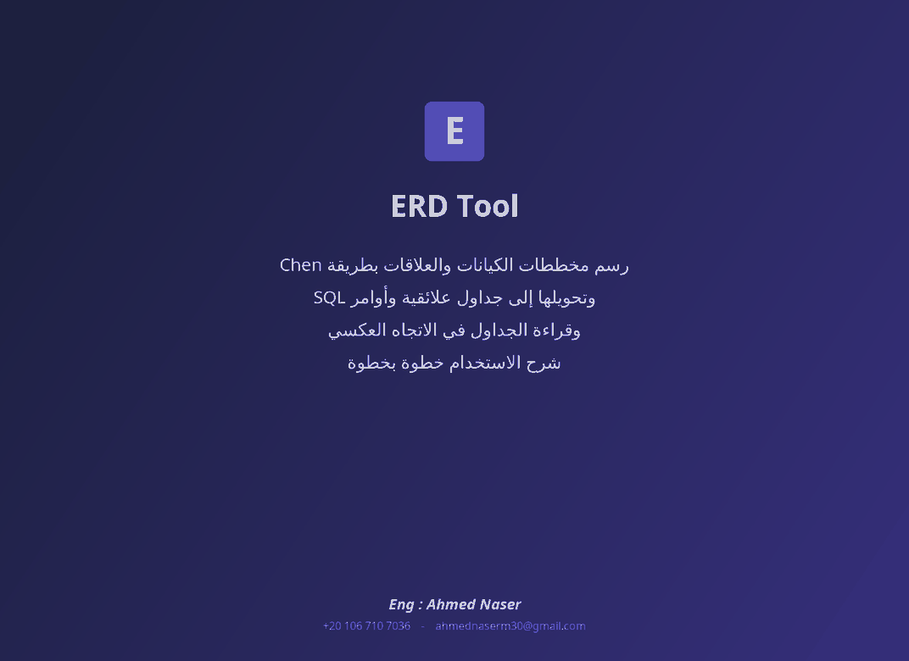

# ERD Tool

A free desktop app for database design. Draw an ER diagram in **Chen notation**, let the tool map it to relational tables by the **seven mapping rules** — with the reason for every step — and get the **SQL**. It also works the other way: read an existing SQL schema back into a diagram.

[-2ea44f?style=for-the-badge&logo=windows)](https://github.com/Ahmednaser30/erd-tool/releases/latest)



## What it does

- **Draw** Chen-notation ER diagrams: strong and weak entities, simple, composite, key and other attributes, relationships with cardinality and participation
- **Check** the diagram before mapping
- **Map** it to relational tables using the seven ER-to-relational mapping rules, with the reason for every step
- **Draw** the resulting tables
- **Generate SQL** for the schema, and edit the tables by hand
- **Reverse-engineer**: read an SQL schema back into a diagram
- **Draft from requirements**: turn a requirement written in plain English into a first diagram
- **Learn**: built-in lessons under *Help > Lessons*

## Download and run

1. Download `ERDTool-1.0-windows.zip` from the [latest release](https://github.com/Ahmednaser30/erd-tool/releases/latest) and unzip it anywhere (a flash drive is fine).
2. **Windows:** double-click `ERDTool.bat`. A Java runtime is bundled in the `jre` folder, so nothing needs to be installed.
3. **Linux / macOS:** the bundled runtime is for Windows; with Java 8 or newer installed, run:

   ```bash
   java -jar ERDTool.jar
   ```

New to the tool? Start with *Help > Lessons*, then open one of the worked examples.

## Examples

The [`examples`](examples) folder holds three worked diagrams — open them with *File > Open*:

| File | Diagram |
|---|---|
| [`company.erd`](examples/company.erd) | COMPANY — the classic lecture case study (employees, departments, projects, dependents) |
| [`musicana.erd`](examples/musicana.erd) | MUSICANA records |
| [`real_estate.erd`](examples/real_estate.erd) | Real estate firm |

## Built with

Java 8 · Swing (desktop UI, no external libraries)

## Author

**Ahmed Naser** — [LinkedIn](https://www.linkedin.com/in/ahmed-naser-aa16741ba/) · [ahmednaserm30@gmail.com](mailto:ahmednaserm30@gmail.com)
